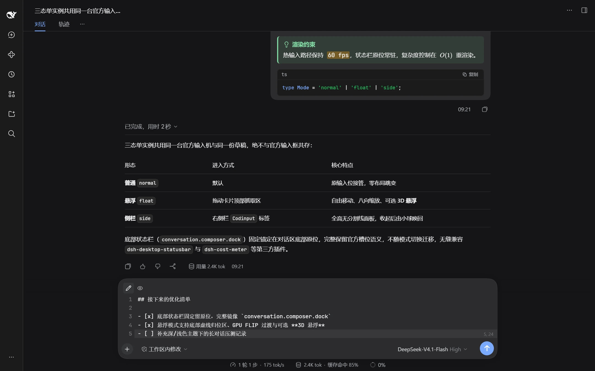

<div align="center">


# DSH-Codinput

[](https://www.npmjs.com/package/dsh-codinput) [](https://github.com/deepseek-ai/deepseek-harness) [](https://www.npmjs.com/package/dsh-codinput) [](https://github.com/0x2fovo/DSH-Codinput/stargazers) [](./LICENSE)

[中文](./README.md) | English

An editor-style input panel, right where the DeepSeek Harness chat composer used to be.

[Features](#features) · [Installation](#installation) · [Theme / Skin](#theme--skin) · [Development](#development--verification)

</div>

## Previews

| Default mode (takes over the original composer slot) | Edit + preview split (strictly 50/50) |
| :---: | :---: |
|  |  |

| Floating mode (draggable, 8-way resizable, optional 3D float) | Sidebar tab mode (full-height panel) |
| :---: | :---: |
|  |  |

## Features

Three mutually exclusive forms sharing one official input machine and one draft — never coexisting with the official composer.

### Three forms

| Form | How to enter | Notes |
| --- | --- | --- |
| **Default** `normal` | automatic | Takeover card sits in the original composer slot |
| **Floating** `float` | drag the centered grab bar or blank area on the card's top row | Detaches into a floating window: drag to move, 8-way resize (position & size remembered), drag back to the bottom dashed dock zone to restore with GPU FLIP transition; optional **3D float** in Settings (spherical viewport tilt, drag-inertia lift, and dynamic lighting/shadows) |
| **Sidebar** `side` | open the **Codinput** tab in the right sidebar | Full-height borderless toolbar panel matching the other two forms; collapsing the sidebar **does not give the slot back** — a small ball below the header recalls it; `/codinput` exits and closes the tab |

- Drafts survive form switches, `/codinput` exits, plugin toggles, and restarts.
- Undo history persists across forms: drag to float or move to the sidebar and back, `Ctrl+Z` still works.

### Editor & performance

- **CodeMirror 6**: fixed 3-digit-width line numbers (toggleable), active-line highlight, soft wrap, `Tab` indent, and line/column indicator; renders characters literally (font ligatures disabled so `->`, `//`, etc. never appear as "missing characters" from host font-shaping quirks).
- **Edit + preview split**: strictly 50/50 layout; live Markdown is computed only when open, refreshed after typing pauses, with debounced scroll sync.
- **Locked 60 fps on long chats & drafts**: the editor and line/col indicator run inside an open ShadowRoot using the native compositor caret; zero React re-renders and zero full-doc string allocation on the typing hot path, on-demand host draft sync, and auto-grow height stabilization during key-repeat bursts (`Enter` / `Backspace`).

### Official-parity input surface

Mirrors official entries and platform primitives wherever possible instead of redrawing them:

- **Model & permissions**: renders the official `ModelSelect` itself (backed by the same directory as `/model`), alongside official permission presets (with full-access risk confirmation) and the plan chip.
- **`/` `@` & command popups**: runs on the full official trigger pipeline (`MenuView` / `PopupSelectView`). Matches official geometry in normal form; uses an adaptive four-side host in float/side forms (never clipped, never overlapping the editor); `/codinput` is slotted alphabetically at the head of commands.
- **Toolbar, voice & hotkeys**: `+` commands button, official voice button (when enabled on desktop), separate send/stop buttons, Continue/Retry triangle on failed turns, official `Tooltip` primitive, and responsive spacing. Send and newline hotkeys support **custom key-combination recording** (defaults: `Enter` for newline, `Ctrl+Enter` to send).
- **Attachments & paste routing**: mirrors the official `ComposerAttachments` rail (thumbnails, original-image lightbox, file cards, progress & retry, drop overlay); supports slash "Add · File", pasting (including document-level paste routing), and drag-and-drop.
- **Full 9 sub-seat mirroring**: `left` / `right` / `model` / `permission` / `plan` / `activity` / `overlay` / `attachments` / `composer.dock` all follow official priority semantics so third-party plugins continue working seamlessly.

### Markdown rendering (offline, zero requests)

The preview pane and user-message bubbles share one rendering pipeline:

- **GFM & Obsidian**: aligned and horizontally scrollable tables, task lists, strikethrough, autolinks, footnotes; 8 collapsible callout families (light/dark contrast checked), `==highlight==`, `%%comments%%`, `[[wikilink|alias]]` (click to copy target), `` sizing, and official image lightbox.
- **Code, math & diagrams**: `highlight.js` for 46 languages with copy button; `KaTeX` inline/block math (20 woff2 fonts inlined as data URIs — **zero network requests**); `Mermaid` for 12 common diagram families (lazy-rendered when visible, theme-reactive, falling back to source + notice on errors or unsupported types).
- **Optional ligatures & instant toggle**: previews and user messages can use a monospace ligature body font (on by default; editor stays literal); toggling user-message Markdown off restores official plain text immediately.
- **Security baseline**: raw HTML is escaped (no forged reference chips), external links get `target=_blank rel=noopener noreferrer`, `javascript:` / `data:` protocols are blocked, KaTeX runs with `trust: false`, and Mermaid SVGs are sanitized via DOMPurify.

### Bottom status dock & settings

- **Bottom status dock (anchored in place, fully native slot)**: `conversation.composer.dock` stays anchored at the bottom of the conversation pane across normal / float / side transitions without unmounting (the drag-dock outline automatically clears the status bar, and narrow windows wrap cleanly). Preserves the exact official `[data-composer-dock="true"]` and `<div data-slot="conversation.composer.dock">` DOM structure with zero self-drawn stats pills, ensuring seamless compatibility with official stats as well as replacement and additive plugins like `dsh-desktop-statusbar` and `dsh-cost-meter`; only the non-slot hardcoded context-occupancy ring is replicated (and yields automatically to replacement statusbar selectors).
- **Settings → Codinput**: takeover toggle, user-message Markdown, line numbers, Markdown monospace ligatures, **3D float**, editor font, hotkey recording, default view, and one-click reset. Opening the **Codinput** sidebar tab automatically re-enables takeover if disabled.

### Architecture: Official mirror vs. replicated vs. plugin-owned

| Area | Classification | Notes |
| --- | --- | --- |
| Model / permission / plan / voice / attachment rail / `/` `@` menu & popups / `composer.dock` stats bar / Tooltip / image lightbox | **Official mirror** | Mirrors official slot entries or uses host `@deepseek-ai/dsh-client-ui-primitives` directly |
| Normal card shell, toolbar chrome (`+` / send / stop), attachment intake handlers, context-occupancy ring, settings controls, user-message bubble shell | **Replicated official** | Corresponding JSX is private inside official entries and not exported; replicated value-for-value using host tokens and live host state |
| CodeMirror 6 editor (ShadowRoot-isolated), split preview, floating/3D float/sidebar forms & four-side adaptive overlay host, Markdown pipeline, hotkey recorder | **Plugin-owned** | No host equivalent; colors inherit from official `--dsw-*` tokens |

## Installation

Requires **desktop DSH `0.2.2-rc.3`** (Electron, host npm `next` channel; `latest` is still `0.2.2-rc.1`). Ships as a self-contained `dsh.client` bundle with **zero runtime transitive dependencies**. `dsh web` and older hosts are no longer maintained.

### Method A: desktop plugin page (recommended)

Open the desktop sidebar **Plugins** → **Add plugin** → search `dsh-codinput` → install. The plugin manager reads `dsh.bundle` metadata, validates `cordis.patch.yml`, and appends the package to your profile's `bundles`.

### Method B: CLI

```bash
dsh plugin --profile desktop add dsh-codinput
```

Replace `desktop` with your local profile name. Restart the desktop app afterwards (or hard-refresh the page; profiles default to `patchReload: live`).

### Other installation methods

- **GitHub source** (the repository ships the prebuilt `lib/client.js`, so no local build is required):

  ```bash
  dsh plugin --profile desktop add github:0x2fovo/DSH-Codinput
  ```

- **Local source development (`link:`)** (does not copy files — run `npm run build` and refresh the page to pick up changes):

  ```bash
  git clone https://github.com/0x2fovo/DSH-Codinput.git
  dsh plugin --profile desktop add link:/abs/path/to/DSH-Codinput
  ```

- **Manual profile config** (`~/.dsh/profiles/desktop/package.json`): add `"dsh-codinput": "^0.6.2"` to `dependencies`, append `"dsh-codinput"` to `dsh.profile.bundles`, run `dsh plugin --profile desktop install`, and restart the desktop app.

## Theme / skin

Codinput ships no palette of its own — every color inherits from the host's `--dsw-*` design tokens (light/dark follows the host):

- **Overriding host tokens changes everything**: overriding `--dsw-*` and `--dsh-scrollbar-*` styles the card, menus, buttons, caret, and scrollbars alongside the official UI. Note that the host defines tokens on `body` (`body[data-ds-dark-theme]`), so override at the same layer (`:root` declarations are overridden by `body`).
- **Official hard-coded values stay parity-matched**: e.g., send icon white foreground and context meter tools purple.
- **Stable class prefix**: outer elements carry `dci-` classes (`.dci-bar-root`, `.dci-card`, `.dci-send`, `.dci-menu`, `.dci-stat-root`, `.dci-ball`, etc.). Styles are injected once into `<style id="dsh-codinput-styles">`, so skins injected afterwards override with standard CSS specificity.
- **ShadowRoot boundary**: `.cm-editor` and `.dci-pos` mount inside `.dci-cm-host`'s open ShadowRoot to isolate typing from host-wide style recalculation. `--dsw-*` / `--dsh-scrollbar-*` CSS variables and `color` inherit automatically, while external `.cm-*` selectors do not cross the shadow boundary; the editor font follows the user preference.

## Development & verification

```bash
npm install              # install devDependencies (bundler / typecheck)
npm run build            # contract check + minified lib/client.js build
npm run build:dev        # unminified build with inline sourcemap
npm test                 # zero-dependency unit test suite (16 suites)
npm run typecheck        # TypeScript typecheck
npm run prepublishOnly   # full release gate (check:popup + test + build + typecheck)
```

See [TESTING.md](./TESTING.md) (manual smoke & release checklists), [scripts/verify/README.md](./scripts/verify/README.md) (isolated-host CDP probes), and [CHANGELOG.md](./CHANGELOG.md).

## Third-party attribution

- **DeepSeek Harness** (`@deepseek-ai/dsh`, MIT License, Copyright (c) 2026 DeepSeek): several SVG icon paths (permission shield glyphs, plus, paperclip, arrow-up, send/stop, generic file glyph, etc.) and CSS values for the composer card and fallback attachment rail are replicated under the MIT license; original notices are retained in [NOTICE](./NOTICE) alongside [LICENSE](./LICENSE).
- **Bundled dependencies** (bundled into `lib/client.js`, zero external runtime deps): CodeMirror 6 (MIT), marked (MIT), DOMPurify (Apache-2.0 / MPL-2.0 dual-licensed, used under Apache-2.0), highlight.js (BSD-3-Clause), KaTeX (MIT), and Mermaid (MIT). Full versions and notices are retained in [NOTICE](./NOTICE).

## Support

If this project helps you, you are welcome to buy me a bowl of rice 🍚:


## License

[MIT](./LICENSE)
