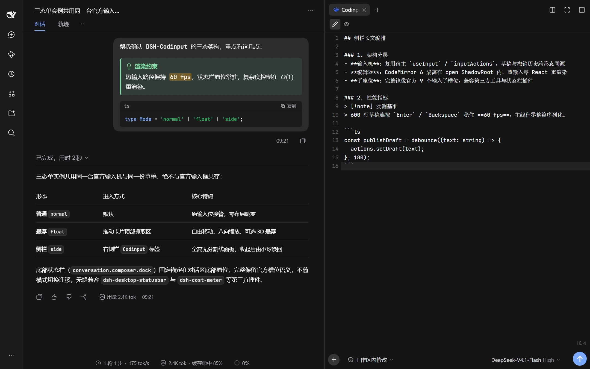

<p align="center">
  
</p>

<h1 align="center">DSH-Codinput</h1>

<p align="center">
  <a href="https://www.npmjs.com/package/dsh-codinput"></a>
  <a href="https://github.com/deepseek-ai/deepseek-harness"></a>
  <a href="https://www.npmjs.com/package/dsh-codinput"></a>
  <a href="https://github.com/Witherwithwinter/DSH-Codinput/stargazers"></a>
  <a href="./LICENSE"></a>
</p>

<p align="center">中文 | <a href="./README.en.md">English</a></p>

<p align="center">把 DeepSeek Harness 的聊天输入框，换成编辑器式的输入面板。</p>

<table>
  <tr>
    <td width="50%"><br /><sub>普通模式（接管原输入位）</sub></td>
    <td width="50%"><br /><sub>编辑 + 预览分屏（严格对半）</sub></td>
  </tr>
  <tr>
    <td width="50%"><br /><sub>悬浮模式（可拖动位置、八向缩放）</sub></td>
    <td width="50%"><br /><sub>侧栏标签模式（VS Code 面板式全高）</sub></td>
  </tr>
</table>

## 功能

把聊天输入框换成编辑器式输入面板：三态单实例，共用同一台官方输入机与同一份草稿。

### 三种形态（复刻官方 + 插件自有）

输入入口只有三种形态，任一时刻恰好一个，绝不与官方输入框共存：

| 形态 | 进入方式 | 说明 |
| --- | --- | --- |
| 普通 `normal` | 默认 | 接管卡片在原输入位 |
| 悬浮 `float` | 按住卡片顶部行空白区拖动 | 脱出为悬浮窗：可拖动位置、可拖边界/角落缩放（位置与尺寸记忆） |
| 侧栏标签 `side` | 打开右侧栏的「Codinput」标签 | 输入在侧栏面板内；**侧栏收起不让位**，由标题栏下方的圆形小球唤回；侧栏里 `/codinput` 直接退回官方输入框并关闭本标签 |

形态切换、`/codinput` 退出再进入、插件禁用、重启都不丢草稿；撤销历史跨形态保留——拖成悬浮、切到侧栏再回来，`Ctrl+Z` 依旧有效。

**性质**：普通形态的卡片外观复刻官方 composer card——官方 InputBar 的卡片外壳是私有 JSX，没有导出组件；悬浮与侧栏形态为插件自有（官方无对应物，容器 chrome 取官方 token）。

### 编辑器（插件自有）

- CodeMirror 6：行号（可关）、当前行与行号高亮、软换行、Tab 缩进、行列指示；编辑器按字面字符渲染（不做字体连字：`->`、`//` 等原样显示，避免宿主字体 shaping 差异造成「丢字符」误判）。
- **编辑 + 预览分屏**（严格对半）：Markdown 实时渲染；预览只在开启时计算、停手后刷新。
- **长草稿连打稳定 60 fps**：本地输入不逐键往返宿主，草稿按需同步官方输入机（停手去抖 + 发送/补全前同步），长按回车换行、长按删除不再卡顿。

**性质**：编辑器与预览分屏为插件自有——官方输入框是私有的 Lexical 编辑器，无法导出复用；只有主题色、光标色、行号栏等取值对齐官方输入区。

### 与官方一致的输入面（官方镜像）

不重画官方已有的组件，而是镜像官方条目/平台原语：

- **模型与推理等级**：直接渲染官方 `ModelSelect`（两段式根菜单、搜索、下钻、加载/失败条带、焦点归还）；读取与 `/model` 同一份官方模型目录。
- **`/` `@` 与 `/model` `/permission` 弹层**：完全走官方触发管线，候选菜单与弹层由官方 `MenuView` / `PopupSelectView` 渲染，普通形态几何与官方输入框一致；悬浮 / 侧栏形态由插件自适应宿主四向选位（不被容器裁剪、不遮编辑区，侧栏落在右侧栏左侧对话区），`/codinput` 按字典序排入指令节首。
- **权限 / 计划**：官方三档权限（含完全权限风险确认）与计划 chip，按官方座位镜像。
- **悬停提示**：宿主官方 `Tooltip` 原语（500 ms、portal、`aria-describedby`）。
- **附件行**：官方 `ComposerAttachments` 条目本体——缩略图/原图灯箱、文件卡、上传进度与失败重试、拖放浮层与文档级拖放监听。
- **语音按钮**：桌面版启用语音插件时，在官方同位置渲染官方语音组件本体（录音、转写、未就绪引导全官方）。
- **继续生成 / 重试**：失败轮次且输入面干净时主按钮变官方 Continue 三角，调用 `retry(failureSeq)`。
- 官方 bar 的全部子座位（`left` / `right` / `model` / `permission` / `plan` / `activity` / `overlay` / `attachments` / `composer.dock`）均按官方语义镜像，第三方替换/追加条目照官方优先级生效。

### 工具行（复刻官方 + 官方镜像）

`+` 指令钮、模型选择、权限选择、计划 chip、语音按钮、发送/停止双按钮（发送瞬间旋转态、运行中独立停止钮）、官方 stop / sending / steer·queue 文案、窄容器自适应间距。发送与换行快捷键可在设置里**任意组合录制**（默认 Enter 换行、Ctrl+Enter 发送）。

**性质**：行容器与 `+` / 发送 / 停止按钮复刻官方 InputBar——这层 JSX 在官方条目内部、不导出，也没有可注册的渲染点，只能按官方 CSS / 图标 / 语义逐值重画；其中的模型、权限、计划、语音与左右座仍是官方条目镜像。

### 附件（官方镜像 + 复刻官方）

slash「添加 · 文件」、**粘贴图片**、**拖文件进卡片**三条路径；缩略图与原图预览（官方灯箱同构）、上传中/失败状态芯片与失败重试。

**性质**：附件行是官方 `ComposerAttachments` 条目镜像；三条入口的行为复刻官方 InputBar——slash / 粘贴 / 拖放的处理逻辑是官方私有实现，无法直接复用，只能按官方行为重写入口并接回官方附件链路。

### Markdown 渲染（插件自有）

预览区与用户消息共用**同一套渲染管线**：

- GFM 表格（对齐、宽表可横向滚动）、任务清单、删除线、自动链接、脚注。
- Obsidian Callouts（note / tip / warning / danger / info / success / question / quote，可折叠，浅深色对比度达标）、`==高亮==`、`%%注释%%`、`[[wikilink|别名]]`（chip，点击复制目标）、图片尺寸 ``、图片点开大图灯箱。
- 代码块：highlight.js 46 种语言高亮 + 语言标签 + 复制按钮。
- 数学公式：KaTeX 行内/块级（20 个 woff2 字体内联 data URI，**零网络请求**，错误公式回退原文）。
- Mermaid：13 类常用图表（flowchart / sequence / class / state / ER / gantt / pie / journey / gitGraph / info / mindmap / timeline），可见时懒渲染、浅深色跟随，语法错误或未内置图类型回退「源码 + 错误提示」。
- 正文可选等宽连字（设置默认开）：预览与消息正文用等宽字体显示 `->`/`=>`/`//` 等连字；编辑器输入框始终保持字面。用户消息 Markdown 开关关闭即还原官方纯文本、无需刷新。
- 安全：原始 HTML 一律转义（不可伪造 chip）、外链 `target=_blank rel=noopener noreferrer`、`javascript:`/`data:` 协议拦截、KaTeX `trust:false`、Mermaid SVG 过 DOMPurify。

**性质**：渲染管线（marked / DOMPurify / KaTeX / Mermaid）为插件自有——官方没有可复用的 Markdown 渲染入口；用户消息气泡的形态按官方气泡结构复刻（官方 user-text 座位被接管后，渲染点只剩插件自己的）。

### 数据行（复刻官方）

卡片下方复刻官方 stats dock：轮次/步数 · tok/s、累计 tok · 缓存命中、上下文占用小圈，取数与格式化逐值同官方；可点开详情面板（会话统计 / Token 用量 / 上下文分段），portal 定位、跟随滚动与尺寸、Escape 与点外关闭。三形态都有。

**性质**：官方 stats dock 渲染在官方 InputBar 内部，接管 bar 后渲染点消失，组件也不对外导出；只能按官方取数、格式化与 CSS 逐值复刻，并接管官方 Activity / Usage 胶囊的读数（数据仍取官方投影 / store）。

### 设置（复刻官方 + 插件自有）

设置 → Codinput：启用接管、行号、字体、Markdown 等宽连字、发送/换行快捷键录制、默认视图；未启用时**打开右侧栏的 Codinput 标签即直接启用**。

**性质**：设置行结构与控件取值复刻官方设置页（官方设置页组件不导出，插件只能注册自己的设置分区并自绘）；快捷键录制器为插件自有。

## 安装

要求：**桌面版 DSH `0.2.2-rc.3`**（Electron）。宿主 npm 频道：`next` = `0.2.2-rc.3`（`latest` 仍是 `0.2.2-rc.1`，完整能力需 rc.3）。插件以 `dsh.client` 客户端 bundle 注入桌面渲染层；`dsh web` 与更早宿主不再维护（旧宿主上模型/权限座回退自绘兜底，输入区弹层不渲染）。

### 方法 A：桌面版插件页（推荐）

打开桌面版侧栏「插件」→「添加插件」→ 搜索 `dsh-codinput` → 安装。插件管理器会读包内的 `dsh.bundle` 元数据、校验自带的 `cordis.patch.yml`，并把包名追加进 profile 的 `bundles`，不需要手写任何 patch 行。

### 方法 B：npm 包（等价 CLI）

```bash
dsh plugin --profile desktop add dsh-codinput
```

`--profile desktop` 按你本地的 profile 名替换。装完重启桌面版（或强刷页面；profile 默认 `patchReload: live`）。

### 方法 C：GitHub 源码

```bash
dsh plugin --profile desktop add github:Witherwithwinter/DSH-Codinput
```

仓库里带着构建产物 `lib/`，装源码同样**不需要本地构建**。如果 pnpm 提示需要构建授权（例如你换成自己的 fork 且删掉了 `lib/`），按它打印的键名写进 profile 的 `pnpm-workspace.yaml` 后重跑：

```yaml
allowBuilds:
  esbuild@0.25.12: true
```

### 方法 D：本地源码

```bash
git clone https://github.com/Witherwithwinter/DSH-Codinput.git
dsh plugin --profile desktop add link:/abs/path/to/DSH-Codinput
```

`link:` 安装不会复制文件，改完 `npm run build` 刷新页面即生效。

### 方法 E：等价的手写配置

想在 profile 里锁版本、或要手工维护时，等价于**方法 A** 的是（`~/.dsh/profiles/desktop/package.json`）：

```jsonc
{
  "dependencies": {
    "dsh-codinput": "^0.5.1"          // 本地开发用 "link:/abs/path/to/DSH-Codinput"
  },
  "dsh": {
    "profile": {
      "bundles": [
        "@deepseek-ai/dsh-base",
        "@deepseek-ai/dsh-web-app",
        "dsh-codinput"                // ← 追加在最后
      ],
      "patchReload": "live"           // 改完 lib/client.js 强刷页面即生效
    }
  }
}
```

改完手工配置后，在 profile 目录里 `pnpm install`（或 `dsh plugin --profile desktop install`），再启动桌面版。

## 主题 / 皮肤

Codinput 不自带配色：全部颜色取自宿主的 `--dsw-*` 设计 token（亮暗主题随宿主切换）。给宿主做主题/皮肤的插件与 Codinput 的相处方式：

- **改宿主 token 即全盘生效**——覆写 `--dsw-*` 变量后，Codinput 的卡片、菜单、按钮、徽章与官方 UI 一同跟随，无需单独适配。注意宿主把 token 定义在 `body`（`body[data-ds-dark-theme]`）上，覆写要写在同一层：写在 `:root` 会被 `body` 上的定义盖掉。
- **官方写死的值 Codinput 同样写死**（发送钮图标的前景白、上下文仪表 tools 分段的紫等），与官方在换肤下的表现保持逐值一致——这些不跟 token 变，属预期行为。
- **要精确点妆 Codinput**：所有元素类名都是稳定的 `dci-` 前缀（卡片 `.dci-card`、发送钮 `.dci-send`、设置菜单 `.dci-menu`、数据行 `.dci-stat-root`、唤回小球 `.dci-ball` 等），可直接作皮肤选择器；插件样式一次性注入 `<style id="dsh-codinput-styles">`，皮肤在其后注入即可按常规 CSS 权重覆盖。
- 编辑器（CodeMirror）的字体是用户偏好（默认等宽栈），不跟随皮肤字体；其颜色同样走 token。

## 第三方归属

本项目的部分视觉素材与样式取值**复刻自 DeepSeek Harness**（`@deepseek-ai/dsh`，MIT License，Copyright (c) 2026 DeepSeek），包括若干 SVG 图标路径（权限盾牌系列、plus / paperclip / close / arrow-up 等）与输入框卡片、原图预览层的 CSS 取值。依 MIT 许可使用，原始版权与许可声明见仓库根目录 [NOTICE](./NOTICE) 与 [LICENSE](./LICENSE)。

内置第三方依赖：CodeMirror 6（MIT）、marked（MIT）、DOMPurify（Apache-2.0 / MPL-2.0 双许可，按 Apache-2.0 使用）——压缩产物不保留许可注释，其版权与许可声明集中保留在 [NOTICE](./NOTICE)。

## 支持

如果这个项目对你有帮助，欢迎请我吃碗白饭 🍚：


## 许可

[MIT](./LICENSE)
