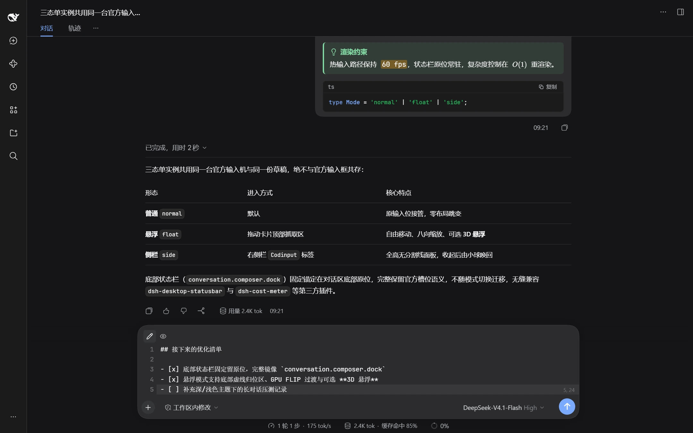
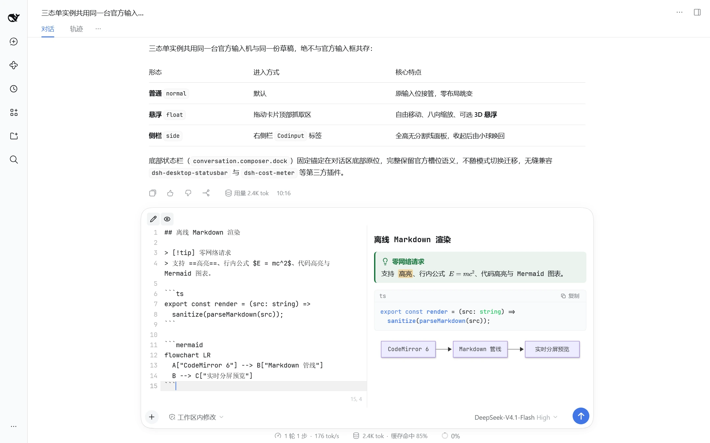
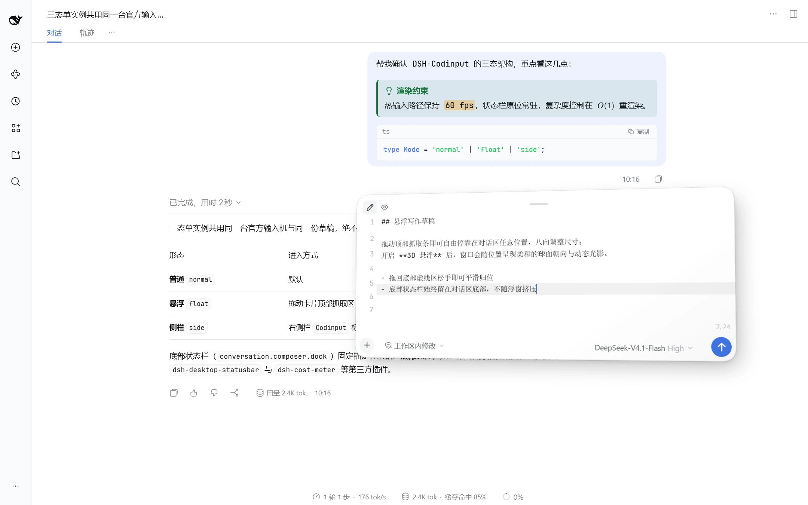

<p align="center">
  
</p>

<h1 align="center">DSH-Codinput</h1>

<p align="center">
  <a href="https://www.npmjs.com/package/dsh-codinput"></a>
  <a href="https://github.com/deepseek-ai/deepseek-harness"></a>
  <a href="https://www.npmjs.com/package/dsh-codinput"></a>
  <a href="https://github.com/Witherwithwinter/DSH-Codinput/stargazers"></a>
  <a href="./LICENSE"></a>
</p>

<p align="center">
  中文 | <a href="./README.en.md">English</a>
</p>

<p align="center">
  把 DeepSeek Harness 的聊天输入框，换成编辑器式的输入面板。<br />
  <a href="#功能">功能</a> · <a href="#安装">安装</a> · <a href="#主题--皮肤">主题适配</a> · <a href="#开发与验证">开发与验证</a>
</p>

<table>
  <tr>
    <td width="50%"><br /><sub>普通模式（接管原输入位）</sub></td>
    <td width="50%"><br /><sub>编辑 + 预览分屏（严格对半）</sub></td>
  </tr>
  <tr>
    <td width="50%"><br /><sub>悬浮模式（可拖动位置、八向缩放）</sub></td>
    <td width="50%"><br /><sub>侧栏标签模式（VS Code 面板式全高）</sub></td>
  </tr>
</table>

## 功能

三态单实例，共用同一台官方输入机与同一份草稿，绝不与官方输入框共存。

### 三种形态

| 形态 | 进入方式 | 说明 |
| --- | --- | --- |
| **普通** `normal` | 默认 | 接管卡片位于原输入位 |
| **悬浮** `float` | 按住卡片顶部空白区拖动 | 脱出为悬浮窗：自由拖动、八向缩放（位置与尺寸记忆），拖回底部输入区恢复普通模式 |
| **侧栏** `side` | 打开右侧栏「Codinput」标签 | 全高面板形态；**侧栏收起不让位**，由标题栏下方圆形小球唤回；侧栏内输入 `/codinput` 退出并关闭标签 |

- 形态切换、`/codinput` 退出再进入、禁用插件或重启都不丢草稿。
- 撤销历史跨形态保留：拖成悬浮或切到侧栏再回来，`Ctrl+Z` 依然有效。

### 编辑器与性能

- **CodeMirror 6**：3 位定宽行号（可关）、当前行高亮、软换行、`Tab` 缩进与行列指示；始终按字面字符渲染（禁用字体连字，避免 `->`、`//` 因宿主 shaping 差异误判丢字）。
- **编辑 + 预览分屏**：严格 50/50 对半布局；预览仅在开启时计算、停手后刷新，滚动同步去抖。
- **长对话 / 长草稿稳定 60 fps**：编辑器与行列指示隔离在 open ShadowRoot 内并采用原生合成器光标；热输入路径零 React 重渲染与整篇字符串分配，草稿按需同步官方输入机，自动增高态连按 `Enter` / `Backspace` 稳高不掉帧。

### 与官方一致的输入面

尽量直接镜像官方组件与平台原语，而非重复造轮子：

- **模型与权限**：直接渲染官方 `ModelSelect`（与 `/model` 共用同一模型目录），镜像官方权限选择器（含完全权限风险确认）与计划 chip。
- **`/` `@` 与指令弹层**：完整走官方触发管线（`MenuView` / `PopupSelectView`）；普通形态与官方几何一致，悬浮 / 侧栏形态由自适应宿主四向选位（不裁剪、不遮挡编辑区）；`/codinput` 按字典序排在指令节首。
- **工具行、语音与快捷键**：`+` 指令钮、官方语音按钮（桌面版启用语音插件时自动镜像）、独立发送/停止钮、失败轮次「继续生成 / 重试」三角、官方 `Tooltip` 与窄容器自适应间距；发送 / 换行快捷键支持**任意组合录制**（默认 `Enter` 换行、`Ctrl+Enter` 发送）。
- **附件与粘贴路由**：镜像官方 `ComposerAttachments`（缩略图 / 原图灯箱、文件卡、进度与重试、拖放浮层），支持 slash「添加 · 文件」、粘贴（含文档级粘贴路由）与拖放。
- **9 个子座位完整镜像**：`left` / `right` / `model` / `permission` / `plan` / `activity` / `overlay` / `attachments` / `composer.dock` 均按官方优先级语义镜像，第三方插件无缝兼容。

### Markdown 渲染（离线零请求）

预览区与用户消息气泡共用同一套渲染管线：

- **GFM & Obsidian**：列对齐与宽表横滚、任务清单、删除线、自动链接、脚注；8 类可折叠 Callouts（浅深色对比度达标）、`==高亮==`、`%%注释%%`、`[[wikilink|别名]]`（点击复制目标）、`` 与官方大图灯箱。
- **代码、公式与图表**：`highlight.js` 46 种语言高亮 + 复制按钮；`KaTeX` 行内/块级公式（20 个 woff2 字体内联 data URI，**零网络请求**）；`Mermaid` 12 类常用图表（可见时懒渲染、跟随浅深色主题，错误或未内置类型回退源码提示）。
- **正文连字与即时开关**：预览与用户消息可选等宽连字字体（默认开，编辑器保持字面）；关闭「用户消息 Markdown 渲染」即时还原官方纯文本。
- **安全基线**：原始 HTML 一律转义（防伪造引用 chip）、外链 `target=_blank rel=noopener noreferrer`、拦截 `javascript:` / `data:` 协议、KaTeX `trust: false`、Mermaid SVG 经 DOMPurify 净化。

### 数据行与设置

- **数据行**：卡片下方复刻官方 stats dock（轮次/步数 · tok/s、累计 tok · 缓存命中、上下文小圈），点击展开三枚互斥详情面板（portal 定位、跟随滚动缩放、`Escape` / 点外关闭）。
- **设置 → Codinput**：接管开关、行号、编辑器字体、用户消息 Markdown、Markdown 等宽连字、快捷键录制与默认视图；接管关闭时，**打开右侧栏 Codinput 标签即自动启用**。

<details>
<summary>架构分工：官方镜像 vs 复刻官方 vs 插件自有</summary>

| 模块 | 实现性质 | 说明 |
| --- | --- | --- |
| 模型 / 权限 / 计划 / 语音 / 附件行 / `/` `@` 菜单与弹层 / Tooltip / 原图灯箱 | **官方镜像** | 直接镜像官方 slot 条目或调用宿主 `@deepseek-ai/dsh-client-ui-primitives` 原语 |
| 普通形态卡片外壳、工具行框架与 `+`/发送/停止钮、附件入口逻辑、数据行、设置页控件、用户消息气泡外壳 | **复刻官方** | 对应 JSX 位于官方私有组件内部且不导出，按官方 CSS / token / 语义逐值复刻并接入官方状态源 |
| CodeMirror 6 编辑器（ShadowRoot 隔离）、编辑/预览分屏、悬浮/侧栏形态与四向自适应宿主、Markdown 管线、快捷键录制器 | **插件自有** | 宿主无对应能力，外观色彩取自官方 `--dsw-*` token |

</details>

## 安装

要求：**桌面版 DSH `0.2.2-rc.3`**（Electron，宿主 npm `next` 频道；`latest` 仍为 `0.2.2-rc.1`，完整能力需 rc.3）。插件以 `dsh.client` bundle 注入渲染层，**0 运行时传递依赖**；`dsh web` 与更早宿主不再维护。

### 方式一：桌面版插件页（推荐）

打开桌面版侧栏 **「插件」→「添加插件」→ 搜索 `dsh-codinput` → 安装**。插件管理器会自动读取 `dsh.bundle` 元数据、校验 `cordis.patch.yml` 并写入 profile 的 `bundles`。

### 方式二：CLI 安装

```bash
dsh plugin --profile desktop add dsh-codinput
```

将 `desktop` 替换为你的本地 profile 名称；安装后重启桌面版（或强刷页面，profile 默认 `patchReload: live`）。

<details>
<summary>其他安装方式：GitHub 源码 / 本地开发 link / 手写配置</summary>

#### GitHub 源码安装

仓库已含预构建产物 `lib/client.js`，直接安装**无需本地构建**（仅本地重新构建或 fork 删除 `lib/` 时才会用到 `devDependencies` 中的 `esbuild`；若 pnpm 提示构建授权，可在 profile 的 `pnpm-workspace.yaml` 中允许 `esbuild@0.25.12: true`）：

```bash
dsh plugin --profile desktop add github:Witherwithwinter/DSH-Codinput
```

#### 本地源码开发（`link:`）

```bash
git clone https://github.com/Witherwithwinter/DSH-Codinput.git
dsh plugin --profile desktop add link:/abs/path/to/DSH-Codinput
```

`link:` 安装不复制文件，修改代码后执行 `npm run build` 并刷新页面即可生效。

#### 手写 profile 配置（`~/.dsh/profiles/desktop/package.json`）

```jsonc
{
  "dependencies": {
    "dsh-codinput": "^0.5.3"          // 本地开发可用 "link:/abs/path/to/DSH-Codinput"
  },
  "dsh": {
    "profile": {
      "bundles": [
        "@deepseek-ai/dsh-base",
        "@deepseek-ai/dsh-web-app",
        "dsh-codinput"                // ← 追加在最后
      ],
      "patchReload": "live"
    }
  }
}
```

保存后在 profile 目录执行 `pnpm install`（或 `dsh plugin --profile desktop install`）并重启桌面版。

</details>

## 主题 / 皮肤

Codinput 不自带配色，全部颜色继承自宿主的 `--dsw-*` 设计 token（自动跟随亮/暗主题）：

- **覆写宿主 token 即全局生效**：覆写 `--dsw-*` 与 `--dsh-scrollbar-*` 后，卡片、菜单、按钮、光标与滚动条随官方 UI 一同换肤。注意宿主将 token 定义在 `body`（`body[data-ds-dark-theme]`），覆写需写在同一层级（写在 `:root` 会被 `body` 覆盖）。
- **官方硬编码保持一致**：如发送按钮白图标、上下文仪表 tools 分段紫色等官方固定值，Codinput 同样保持逐值对齐。
- **稳定类名前缀**：外层元素统一使用 `dci-` 前缀（`.dci-card`、`.dci-send`、`.dci-menu`、`.dci-stat-root`、`.dci-ball` 等），样式一次性注入 `<style id="dsh-codinput-styles">`，皮肤在其后注入即可按常规优先级覆盖。
- **ShadowRoot 边界**：`.cm-editor` 与 `.dci-pos` 挂载在 `.dci-cm-host` 的 open ShadowRoot 内以隔离宿主样式重算；`--dsw-*` / `--dsh-scrollbar-*` 变量与 `color` 自动穿透继承，外部 `.cm-*` 选择器不直接穿透，编辑器字体由用户偏好控制。

## 开发与验证

```bash
npm install              # 安装开发依赖（打包与类型检查）
npm run build            # 契约自检 + 构建压缩版 lib/client.js
npm run build:dev        # 构建带内联 sourcemap 的开发产物
npm test                 # 运行零依赖单元测试（10 组）
npm run typecheck        # TypeScript 类型检查
npm run prepublishOnly   # 完整发布门禁（check:popup + test + build + typecheck）
```

更多说明见 [TESTING.md](./TESTING.md)（手工冒烟与版本验收清单）、[scripts/verify/README.md](./scripts/verify/README.md)（隔离宿主 CDP 自动化探针）与 [CHANGELOG.md](./CHANGELOG.md)。

## 第三方归属

- **DeepSeek Harness**（`@deepseek-ai/dsh`，MIT License，Copyright (c) 2026 DeepSeek）：部分 SVG 图标路径（权限盾牌系列、plus / paperclip / arrow-up / 发送与停止 / 通用文件图形等）及输入框卡片、附件轨兜底视图的 CSS 取值复刻自官方包，原始版权与许可声明保留在 [NOTICE](./NOTICE) 与 [LICENSE](./LICENSE)。
- **内置前端依赖**（随 `lib/client.js` 打包，终端用户零运行时传递依赖）：CodeMirror 6（MIT）、marked（MIT）、DOMPurify（Apache-2.0 / MPL-2.0 双许可，按 Apache-2.0 使用）、highlight.js（BSD-3-Clause）、KaTeX（MIT）、Mermaid（MIT）。完整版本与版权清单见 [NOTICE](./NOTICE)。

## 支持

如果这个项目对你有帮助，欢迎请我吃碗白饭 🍚：


## 许可

[MIT](./LICENSE)
